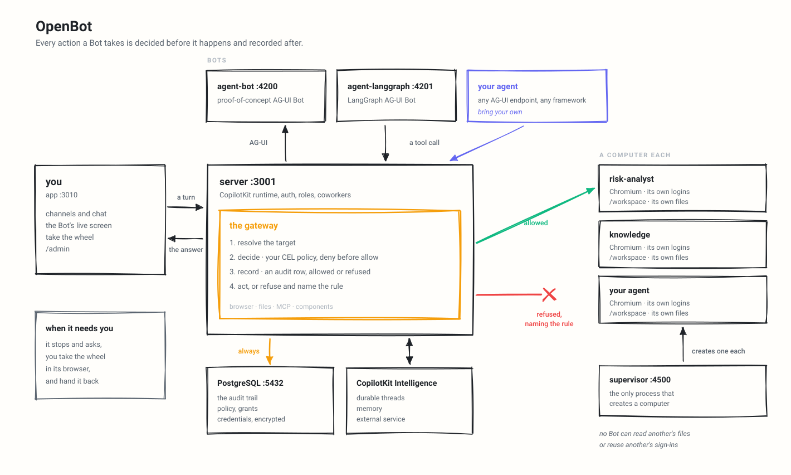

# 架构

OpenBot 结合了 React 应用、Hono API 服务器、PostgreSQL、CopilotKit Intelligence、AG-UI Bot 端点以及受管控的浏览器计算机。

<picture>
  <source media="(prefers-color-scheme: dark)" srcset="../assets/architecture-dark.svg">
  
</picture>

在更改图中所示的任何内容后，使用 `bun run diagram` 重新生成它。

## 服务与端口

| 组件                     | 端口                       | 职责                                                                                                                              |
| ------------------------ | -------------------------- | ------------------------------------------------------------------------------------------------------------------------------------------- |
| `app`                    | 3010                       | 用于频道、Bot 聊天、实时屏幕、设置和管理页面的 React/Vite 界面。                                                        |
| `server`                 | 3001                       | API、CopilotKit 运行时、认证、角色、租户包、同事、频道、策略、审计、凭据、插件、组件和连接器。 |
| `agent-computer`         | 4100                       | Chromium、`/workspace`、浏览器配置文件、截图、快照和文件工具。                                                            |
| `agent-bot`              | 4200                       | 概念验证 AG-UI Bot。                                                                                                                     |
| `agent-langgraph`        | 4201                       | LangGraph AG-UI Bot。                                                                                                                        |
| `agent-harness`          | 4202                       | 在设置期间选择的 Bot 框架 harness，即 `agent-<framework>` 镜像之一，位于 `harness` compose profile 之后。                 |
| `supervisor`             | 4500 主机 / 4300 容器 | 创建、停止、重置并列出每个 Bot 的计算机容器。                                                                              |
| 带 pgvector 的 PostgreSQL | 5432                       | 产品数据、审计记录、凭据、策略、授权、频道和组件。                                           |
| CopilotKit Intelligence  | 外部                   | 持久化线程、记忆和实时网关。                                                                                              |

`scripts/start.sh` 通过 Docker Compose 启动 PostgreSQL、`agent-computer`、`agent-langgraph`、`agent-bot`（当 `BOT_PROVIDER=anthropic` 时跳过，因为该示例只接受 OpenAI 密钥）以及 supervisor（除非 `OPENBOT_ONE_COMPUTER_EACH=false`），并运行 `migrate`。随后它在主机上启动 `server`、routines worker（`bun worker/src/index.ts`，即 routines CronJob 的本地替代）和 `app`。

compose 文件还定义了可选的 SPIRE 服务。`start.sh` 不会启动它们。

## 运行时流程

1. 应用打开一个频道或直接 Bot 会话。
2. 服务器解析已登录的操作者和选定的同事。
3. CopilotKit 运行时将这一轮对话发送到已配置的 AG-UI 端点。
4. 界面注册可用的前端工具：浏览器工具、MCP 工具，以及授予该 Bot 的组件。
5. 执行浏览器/文件/MCP 调用会返回服务器进行授权和审计。
6. 服务器将结果流式返回给应用和 Intelligence 线程。

## 浏览器操作治理

计算机本身不决定策略。服务器网关才是操作边界：

1. 从服务器持有的快照或请求主体中解析目标；
2. 评估当前操作策略；
3. 为该决策写入一行审计记录；
4. 仅当决策为放行时才调用计算机；
5. 如果被放行的操作失败，则写入第二行审计记录。

策略规则可以检查：

- `tool.name`
- `intent`
- `bot.id`
- `actor.id`
- `page.url`、`page.host`
- `element.ref`、`element.role`、`element.name`、`element.type`
- `key`
- `command`
- `file.path`、`file.name`、`file.extension`
- `mcp.server`、`mcp.tool`、`mcp.effect`
- `initiator.kind`、`initiator.id` —— 是什么启动了这次运行，与它携带的是谁的权限不同。取值为 `person`、`deployment`、`routine` 或 `handoff`，在有 routine 或 Bot id 时一并给出。在定时运行中，`actor.id` 是 routine 的所有者，因此这是唯一能区分无人值守运行与有人手动输入的字段。

规则使用 CEL 表达式，外加不区分大小写的 `contains()` 和 `matches()`。拒绝规则先于允许规则评估。策略引擎采用故障关闭（fail closed）机制：缺失或空策略不允许任何操作，损坏的拒绝规则会拒绝，损坏的允许规则不会放行。OpenBot 随附的启动默认值是明确的：`deny: []` 和 `allow: ["true"]`，除非 `AGENT_COMPUTER_POLICY` 或已保存的管理员策略将其替换。格式错误的已配置策略会阻止服务器启动。

## 计算机

`agent-computer` 需要 `COMPUTER_TOKEN`，没有它时仅允许访问 `/health`。Docker Compose 将其绑定到 `127.0.0.1:4100`。

Compose 将其置于与 PostgreSQL 不同的网络上。Bot 拥有 shell，而 shell 能到达其容器能到达的任何地方，因此数据库位于仅承载自身和 `migrate` 的 `data` 网络上，其他一切则位于 `default` 网络上。在 Compose 内而非主机上运行 API 服务器的部署会将其同时加入两个网络，这是两者唯一的交汇点。

使用 `COMPUTER_SUPERVISOR_URL` 时，每个 Bot 都会获得自己的计算机容器、工作区卷和浏览器配置文件。不使用它时，所有 Bot 共享 `AGENT_COMPUTER_URL`。

每台计算机还会过滤自己的出站连接。浏览器和 shell 命令会经过一个过滤代理，该代理应用 Bot 的网络策略（`allow_all`、`defaults_plus_allowlist`、`allowlist_only` 或 `deny_all`，当 Bot 所有者的 Cloud 网络访问被关闭时，Bot 得到的就是 `deny_all`）。服务器在计算机执行操作之前以及每次计算机唤醒时推送该策略，在策略到达之前，任何内容都不得离开。`EGRESS_POLICY_REQUIRED=0` 用于没有 API 服务器运行的计算机。云元数据地址在所有模式下都会被拒绝。忽略代理变量并打开原始套接字的进程不会被此机制阻止；那是 Kubernetes NetworkPolicy 的职责。

计算机上的命令会继承 PATH、locale 和终端名称，以及代理变量，但不继承进程环境的其余部分。代理 URL 中的用户信息会被剥离。`COMPUTER_SHELL_ENV` 指定部署希望传递的其他任何内容。

supervisor 仅暴露 ensure、stop、reset 和 list 操作。它持有 Docker socket，因此不要将其暴露在部署网络之外：Docker Compose 将其绑定到 `127.0.0.1:4500`，而在 compose 网络内运行服务器的部署可通过 `supervisor:4300` 访问它，完全不需要发布端口。在支持的主机上设置 `COMPUTER_RUNTIME=runsc` 以在 gVisor 下运行计算机。

## 是什么启动了一次运行

每一行审计记录都会记录操作是依据谁的权限执行的。routine 或 Responsibility 会声明其所有者，Bot 之间的一次跳转会声明发起对话的人，因此仅凭该列无法说明事情发生时是否有人在现场。交互式运行有某个人在旁观察，会注意到错误的工具调用；无人值守的运行则没有，而这正是值得能够找出的情况。

因此每一行还会指明是什么导致了它：

| `initiator_kind` | `initiator_id`         | 含义                                          |
| ---------------- | ---------------------- | ------------------------------------------------------ |
| `person`         | 无                   | 有人在现场。默认值。                  |
| `deployment`     | 无                   | 部署本身，在启动时或拒绝无法识别的调用者时。 |
| `routine`        | routine 的 id       | 由调度触发，以其所有者身份运行，无人现场。   |
| `responsibility` | Responsibility 的 id | Bot 的某个常设 Responsibility 被触发，以其所有者身份运行，无人现场。 |
| `memory`         | 记忆来源的 id | 记忆读取某个已连接的应用以导入事实，以来源所有者的身份运行。 |
| `handoff`        | 移交的 Bot | 另一个 Bot 代表该人请求了此操作。     |

Audit 屏幕会据此过滤，而 **Nobody watching** 是 `routine`、`handoff`、`responsibility` 和 `memory` 的合集，即某人不在时以其权限运行了什么。`deployment` 被有意排除在该过滤器之外：启动时守住的边界不是代表任何人所做的工作。

`deployment` 的存在是为了让该列永远不会过度声明。一行写着 `person` 的记录就是由人导致的记录，而完全没有人的两个地方——启动行和两次未认证的边界拒绝——会如实说明，而不是借用默认值。一个从未运行过 routine 或跳转的部署，在每一行由人产生的记录上都会看到 `A person`，这与该功能存在之前的行为一致。

该值随签名运行断言一起传递，与 `depth` 并列，原因与 `depth` 相同：一次跳转是一个 pod 上的一次运行移交给另一个 pod 上的另一次运行，而知道是 routine 启动了它的进程是认领该 routine 的那个进程，而不是写入该行的进程。任何持有该断言的东西都持有答案，因此一次工具调用、在工位上被提供或拒绝的一次跳转、一个停下来询问其对应人员的 Bot，以及一个停滞的流，都会说出同样的事情，而无需各自被单独告知。Bot 无法重新标记自己的运行，因为断言由部署签名，而该部署不会写入的 kind 会被读取为 person，而不是被保留。

计算机操作也会携带 initiator。没有附加浏览器的运行（routine、Responsibility、群组对话轮次）会在服务器端获得计算机工具，在模型提供任何参数之前就绑定好 Bot 和人员，网关会在每个决策上写入该运行的 initiator。

### 导出审计轨迹

Audit 屏幕的 **Export CSV** 会将当前过滤器下载为 `GET /api/admin/audit-events?format=csv`：与表格相同的过滤查询，逐页遍历最多 5,000 行，并以 RFC 4180 CSV 返回，其中脱敏后的载荷作为单个 JSON 列。达到上限的导出会保留最新的 5,000 行，并以 `X-Audit-Export-Truncated`（行数）作答，屏幕也会如此说明，因此审查者应缩小 `from`/`to` 或过滤器范围，而不是引用不完整的轨迹。以 `=`, `+`, `-` 或 `@` 开头的单元格会加上 `'` 前缀，因此某人选择的名称或 URL 在电子表格中会作为文本打开，而绝不会作为公式。每次导出本身都会被记录为 `audit.exported`，包含导出者、行数以及所用过滤器。未知的 `format` 会返回 400，与任何其他格式错误的审计查询一样。

## 人工控制与机密

交接会作为控制事件被审计：

- `computer.help_requested`
- `computer.control_taken`
- `computer.control_released`

当有人控制浏览器时，Bot 操作会被拒绝而非排队。没有附加浏览器的运行则会暂停，等待交接。

交接也是 Bot 无法通过的机器人检查（"Verify you are human" 页面、CAPTCHA）的设计回退方案。OpenBot 会降低这种情况发生的频率（有头 Chromium、可选的 Web Bot Auth 签名、可选的家庭住宅代理；参见[通过机器人检查](configuration.md#getting-past-bot-checks)），并且绝不会代表任何人解决它：Bot 发出请求，人员在实时屏幕中解决，然后交还控制权。帮助请求会记录其发起时所处的页面，因此在此期间重启的计算机重新打开的是该页面，而不是交出一个空白浏览器。

机密输入与聊天内容分开。审计轨迹会记录请求或提供了机密以及字符数，而不是机密值。

## 观察 Bot 工作

对话旁边有两个界面。屏幕是实时浏览器，通过 websocket 代理，并与其他所有关于该 Bot 的路由一样受同一问题的门控。Activity 标签页是 Bot 在浏览器之外所做的事情：每一条命令及其输出和退出码，每一次文件读取、写入和列表，最新的在前。

Activity 保存在浏览器中，针对当前打开的对话，重新加载后即消失。它是一个窗口而非记录；记录是审计轨迹，它位于服务器端、能在重启后保留，是调查时读取的内容。已保存的文件只贡献其路径和大小，绝不贡献其内容，这与写入路由一致——写入路由拒绝回显它们，因为 Bot 可能正在保存被告知为机密的内容。

## 同事与频道

同事是一个持久的 Bot 配置文件：

- `agents` 存储运行时身份以及端点/密钥引用。
- `agent_profiles` 存储名称、头衔、角色、所有者、可见性和删除状态。
- `agent_preferences` 存储每个用户的名单状态。

频道是与一个同事的对话，外加一个 CopilotKit Intelligence 线程映射。启动新频道会创建一个新线程。

群组对话容纳多个 Bot。一个 Intelligence 线程只接纳一个 agent，因此每个 Bot 在群组中都有自己的线程（`group_bot_threads`），而其中的人读到的是共享的对话记录（`group_messages`），每条回复都归属于其发言者。将某个同伴命名为 `@Name` 的 Bot 会在相同的授权、上限和审计记录下将对话移交给它，与任何其他跳转一样。

谁可以访问某个频道由成员资格决定：每个频道路由都会在 `channel_memberships` 中解析调用者，没有记录则拒绝。`channels.allowed_groups` 在租户包中声明并存储，但不属于该决策的一部分——`users.groups` 从不会被任何登录路径填充，因此基于组的规则没有任何可评估的内容。应将其视为等待身份提供方提供组成员资格的声明，而不是正在运行的控制措施。

参见 [coworkers.md](coworkers.md)。

## Routines

routine 是一条常设指令，通过在频道中询问 Bot 而非通过表单创建，它会按调度触发，并以其创建者的身份将回复发布到该频道中。

发现 routine 到期的扫描与计算机清理器共用同一个机制：两者都写入 `work_items`，这是一张 PostgreSQL 表，通过 `select ... for update skip locked` 认领，租约按数据库自身的时钟计时，并设有尝试次数上限。两者都不作为 API 内部的定时器运行，因为定时器会在每个副本中触发，每个副本都会独立判定同一次触发或同一次暂停到期；队列的作用正是让恰好一个副本认领它，而其他所有副本的尝试都会与同一行无害地冲突。参见 [routines.md](routines.md)。

## 组件

组件是前端工具，Bot 可以调用它们，而不是仅以散文作答。

来源：

- `app/src/components/gallery/` 中编译后的 React 组件；
- 从 `/admin/playground` 编写并发布的沙箱化组件。

治理：

- 编译后的组件在应用目录同步首次发现时即发布；
- 沙箱化组件保存为草稿，仅在发布后才可用；
- 每次调用都会询问服务器该组件是否存在、是否已发布、是否未对该 Bot 保留；
- 组件数据函数需要单独的按组件授权。

随附的组件数据函数会读取审计轨迹：`botActivity` 和 `recentRefusals`。

## 一个 Bot 将工作移交给另一个

Bot 可以寻址另一个 Bot，被寻址的 Bot 会自行作答，而不是由第一个 Bot 代为转述文本。

`message_bot` 与 Bot 已授予的工具并列提供，因此哪些 Bot 可以到达哪些 Bot 是一种普通的授权：带 `bot` kind 的 `plugin_grants`。未被授予任何对象的 Bot 不会被提供任何东西。

它所需的内容是有类型的。发起请求的模型会命名任务、任何约束它的条件以及好的答案是什么样子，而不是写一段文字。自由文本是交接悄然出错的最常见方式：接收方 Bot 推断意图、猜测约束，而当它猜错时，它不会失败，而是自信地给出别的答案。

有四件事由部署决定，绝不由模型决定：

- **正在寻址谁**，根据发起请求的人可见的名单解析。Bot 不得到达其对应人员无法到达的 Bot，否则这就是绕过 agent 可见性的一种方式。不存在的 Bot 与不属于其可见范围的 Bot 会以相同的措辞被拒绝，因此这无法枚举名单。
- **答案落在哪里**，来自签名的运行断言。否则 Bot 可能将一轮对话丢进它从未参与的对话中。
- **谁在请求**，从该部署写入的行中盖章。能够写入自己归属的 Bot 可以声称自己是另一个 Bot。
- **链条有多深**，同样来自断言，这正是阻止 A 请求 B 请求 C 请求 A 无限循环的机制。

第二个 Bot 以同一个人身份运行，拥有自己的角色和自己的授权，因此它看到的是该人可见的内容，不会更多。

**答案落在该 Bot 与这个人自己的对话中。** 不是发起请求的那个对话，这是平台的一个属性而非一种选择：一个 Intelligence 线程只属于一个 agent。因此发起请求的对话会说明工作去了哪里，而作答的对话会带着未读标记移到名单顶部。这个人会得到两半。

作答对话保留的是一行说明谁请求了什么，而不是信封。这是两段文本、两个读者：模型需要任务、约束和好答案的形态，而滚动浏览的人需要知道那个 Bot 为什么突然开口。发起请求对话的历史会被被寻址的 Bot 作为上下文读取，而不会被重复进对话记录中。

**彻底失败的跳转会明说。** 当一次跳转用尽尝试次数时，发起请求的 Bot 会被送回这个人正在观看的对话中，明确说明没有任何内容返回。否则，一个被移交却从未得到回答的问题与一个缓慢的问题无法区分，对话就只是停住了。

**跳转是被认领的工作，而不是回调。** 它是空闲计算机清理器所用同一